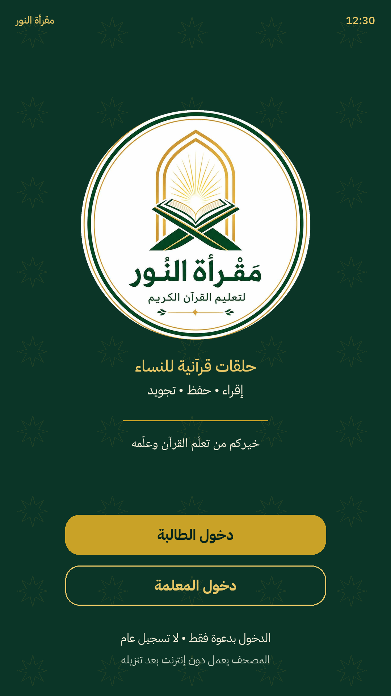

# مقرأة النور — لتعليم القرآن الكريم

تطبيق مقرأة قرآنية للنساء، بديل عن مجموعات الواتساب: تحكم كامل للمعلمة،
وتواصل فردي وجماعي، وتقسيم إلى فصول ومستويات، ومكالمات صوت وصورة،
ومصحف متزامن يظهر عند الإقراء والقراءة.

> **هذا المستودع يحوي تصميم النسخة الأولى v1.1 ومشروع الأندرويد
> الكامل بالتصميم مركّبا فيه (`android/`). انظر قسم «مشروع الأندرويد»
> أدناه لحدود النسخة بصدق.**

## مشروع الأندرويد

المشروع في `android/` — الاسم اللاتيني **Maqraatal-Noor**، ومعرّف
التطبيق `org.maqraatalnoor`، واسم العرض «مقرأة النور». Kotlin +
Compose + Material 3، عربي وحده وRTL، والشاشات الثماني مطابقة
للتصميم، ببيانات محلية تجريبية بلا خادم. التفاصيل وأمر البناء في
`android/README.md`، والتقرير الصادق في `android/REPORT.md`.

حدود النسخة باختصار: لا مكالمات حقيقية (محاكاة حالة محلية فقط)،
ولا مصحف كامل (صفحة الفاتحة عينة فقط)، ولا حسابات ولا خادم،
وخط ثمانية غير مضمَّن إطلاقا (استيراد يدوي فقط). **لم يُتحقق
البناء الكامل في بيئة التطوير هنا** (عطل Gradle daemon المعروف) —
الخطوة التالية بيد يعقوب في Android Studio، كما في `REPORT.md`.

## التصميم

| الشاشة | الملف |
|---|---|
| الدخول | `01-splash.png` |
| الرئيسية للطالبة | `02-home.png` |
| الفصول والمستويات | `03-classes-levels.png` |
| الحلقة الحية | `04-live-halqa.png` |
| المصحف | `05-mushaf.png` |
| تحكم المعلمة | `06-teacher-control.png` |
| الجلسة الفردية | `07-private-session.png` |
| دليل الهوية | `08-design-system.png` |
| دليل استخدام الشعار | `09-logo-usage.png` |

دليل التصميم الكامل (الألوان والخطوط والقياسات وقواعد الخصوصية):
`DESIGN-SPEC.md`. الشاشات مرسومة بالكود بمقاس 1080×1920،
وسكربت إعادة الرسم هو `render.py` (يتطلب Pillow؛ يستخدم خطوط
IBM Plex Sans Arabic إن وُجدت، وإلا خط Noto Sans Arabic من النظام).



## الشعار الرسمي

الشعار المسلَّم من المقرأة محفوظ دون تعديل في
`logo/maqraat-al-noor-logo.jpg` (1254×1254). لا يُعاد رسمه ولا تُغيَّر
ألوانه. في `logo/` أيضا: نسخة دائرية شفافة للخلفيات الداكنة، وعلامة
مصغرة للأحجام الصغيرة مقصوصة من الملف نفسه، وأيقونة تطبيق 1024×1024.
دليل الاستخدام في `09-logo-usage.png`.

## الخط — تنبيه مهم

خط الواجهة الأساسي في التصميم هو **خط ثمانية**، ويُنزَّل يدويا من
الصفحة الرسمية فقط (`ask.thmanyah.com`) بصيغة OTF. ترخيصه يمنع إعادة
توزيع ملفات الخط، بما فيه إرسالها لزميل، ويمنع رفعها أو استضافتها
خارج المصدر الرسمي — **فلا ترسل ملف الخط لأحد**.

الصور المسلَّمة رُسمت بخط IBM Plex Sans Arabic بديلا موثقا، لأن ملف
ثمانية غير موجود في بيئة الرسم. والنموذج المتوافق مع الترخيص، كما في
«مرآة»، هو الاستيراد اليدوي من المستخدم على جهازه، بلا تضمين للملف.
وقرار تضمين الخط في تطبيق أندرويد لاحقا غير محسوم: في صفحة الأسئلة
توتر لم يُحسم (سؤال يقول إن الخط غير معدّ للتثبيت على iOS أو Android،
وآخر يجيزه في واجهات التطبيقات)، ونص الترخيص الكامل يصل مع رسالة
التنزيل فقط ولم يُقرأ — فيجب قراءته قبل أي تضمين. نص المصحف لا يُكتب
بخط ثمانية أبدا، بل بخط نسخي عثماني.

## البنية

```
01-splash.png … 09-logo-usage.png   شاشات التصميم ودليل الشعار
DESIGN-SPEC.md                      دليل التصميم
render.py                           سكربت رسم الشاشات
make_logo_sheet.py                  سكربت ورقة استخدام الشعار
logo/                               الشعار الأصلي ومشتقاته
android/                            مشروع الأندرويد (Maqraatal-Noor) بالتصميم مركّبا فيه
```
